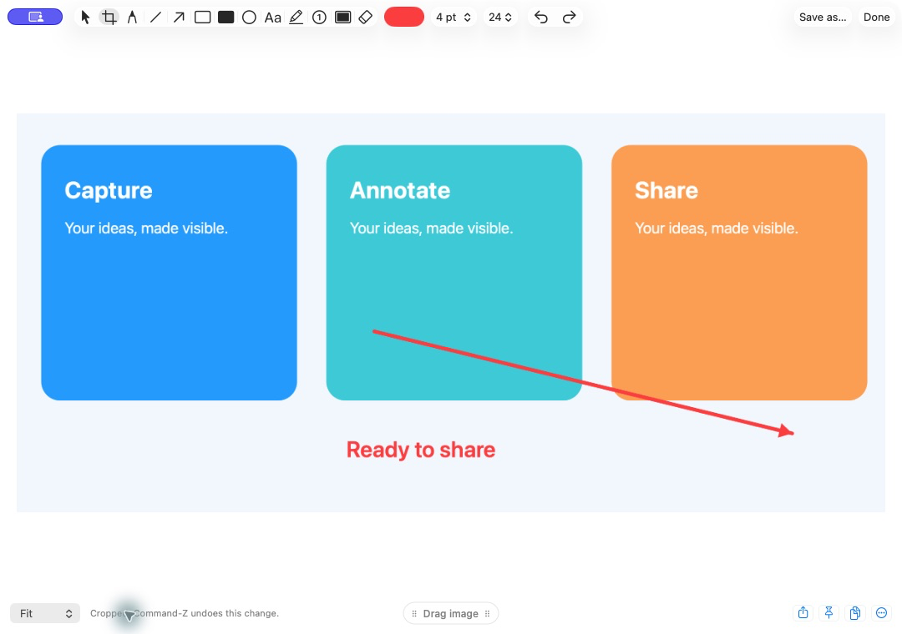

# OpenToolkit

### Speak it. Capture it. Make it clear.

Your everyday Mac tools in one local app — dictation, screenshots, screen annotation and recording, with optional notes.

**Apple Silicon · macOS 14+ · Early preview**

| | What you can do |
| --- | --- |
| 🎙️ **Dictation** | Hold **Fn** and speak into your text box. Choose Parakeet or Whisper, live typing, colours and sounds. |
| 🪄 **Word corrections** | Review suggested corrections after editing a dictation. Save a replacement, undo it, or disable it in Corrections. Support depends on the target text box. |
| ↩️ **Recover a transcript** | **Double-tap Shift** to paste your last saved transcript. Triple-tap to open history. The key is customisable. |
| 👋 **Hey Toolkit** | Say the wake phrase, wait for the cue, then choose a command. Wake listening is optional. |
| ✨ **Writing modes** | Tidy spacing, format messages, or use a separate local AI model for bullet summaries and email drafts. |
| 📸 **Screenshots** | Capture a freeform area or full screen. Keep recent captures nearby, edit them, or drag them into another app. |
| ✏️ **Screenshot editor** | Crop, add text, arrows, shapes, numbered markers and redaction. Undo, zoom, combine images, copy or save. |
| 🖍️ **Screen annotation** | Draw over your screen with configurable hotkeys, then clear it when finished. |
| 🎬 **Screen recording** | Capture a region as video or GIF. Capture options include fixed dimensions and scrolling screenshots. |
| 📝 **Notes · experimental** | Optional local notes, folders, keyword search and meeting transcripts. Off by default. |



*The actual editor, using demonstration artwork. Your captures stay local unless you choose to share them.*

## Say “Hey Toolkit”

```text
“Hey Toolkit” → wait for the sound / waveform → “start dictating”
                                             “take a screenshot”
                                             “summarize into bullet points”
                                             “turn this into an email”
```

The command window lasts eight seconds. To finish, say **“Hey Toolkit”**, wait for its cue, then **“stop transcribing”**. Change the wake phrase and actions in **Dictation → Customize wake phrase & commands**. Sending, Notes and meeting capture require their settings to be enabled. AI writing needs a local text model such as one served by LM Studio.

## Get started

**Source preview:** install Python 3.12 and Xcode Command Line Tools, clone this repository, then run:

```sh
python3.12 scripts/install.py --check
python3.12 scripts/install.py
```

The app appears in `~/Applications/OpenToolkit.app`, in the Dock and in the menu bar. Setup downloads the speech dependencies and model, then guides you through the required Mac permissions. It does not import another app’s history.

**DMG:** download the notarized DMG from [GitHub Releases](https://github.com/Barty-Bart/opentoolkit/releases), open it and drag OpenToolkit into Applications. To update later, choose **Check for Updates…** in the menu bar: OpenToolkit downloads the new release, checks that Apple notarized it and that it's signed by the same developer, then restarts into the new version. Your history, settings and permissions stay as they are.

[Installation, updating and existing models →](docs/installation.md)

## Useful shortcuts

| Action | Default |
| --- | --- |
| Dictate | Hold Fn, or tap to toggle |
| Recover last transcript / open history | Double / triple Shift |
| Capture area | ⌘ ⇧ 4 |
| Capture full screen | ⌘ ⇧ 3 |
| Capture options: dimensions, scrolling, video & GIF | ⌘ ⇧ 5 |

Shortcuts are configurable. Disable conflicting shortcuts in another capture tool or macOS if necessary.

## Local by default

Speech recognition runs on your Mac. History, approved corrections, notes and captures are stored locally. No telemetry, account, cloud transcription or sync. Optional AI writing connects only to a local server you choose. Microphone dictation does not require FFmpeg.

This is an early preview. Text-box insertion, correction detection and screenshot behaviour are still being hardened; test them in your own apps before relying on them. English is configured, screen recording with microphone needs macOS 15+, and older supported macOS versions still need hardware testing. Notes AI summaries, semantic search, profile sync and camera overlays are future work.

[Privacy and limitations](docs/privacy-and-limits.md) · [Testing](docs/testing.md) · [Report a problem](https://github.com/Barty-Bart/opentoolkit/issues)

Please use a synthetic example when reporting a bug. Do not upload your private transcripts, recordings, screenshots or credentials.

## License

OpenToolkit is released under the [MIT License](LICENSE). Bundled third-party components keep their own licenses; their notices ship inside the app.
