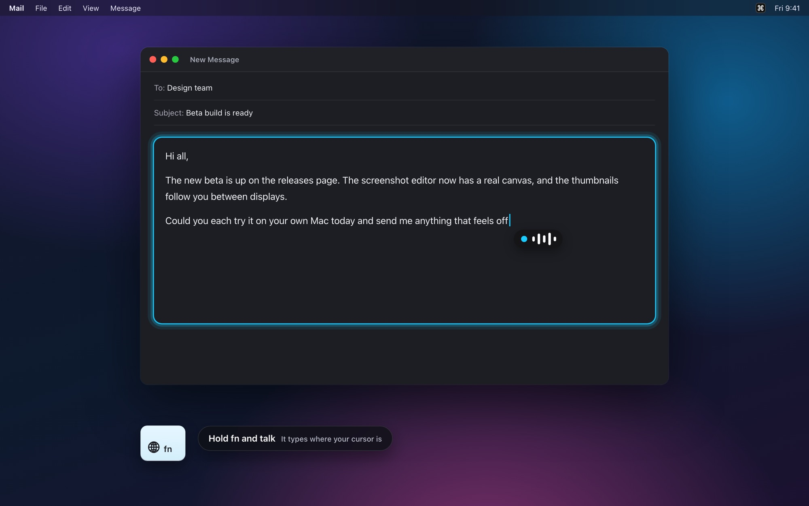
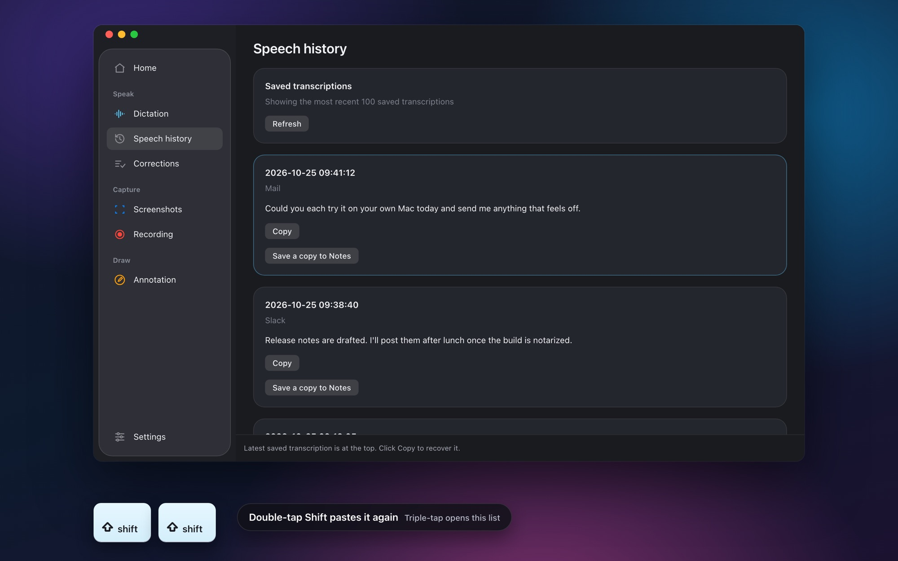
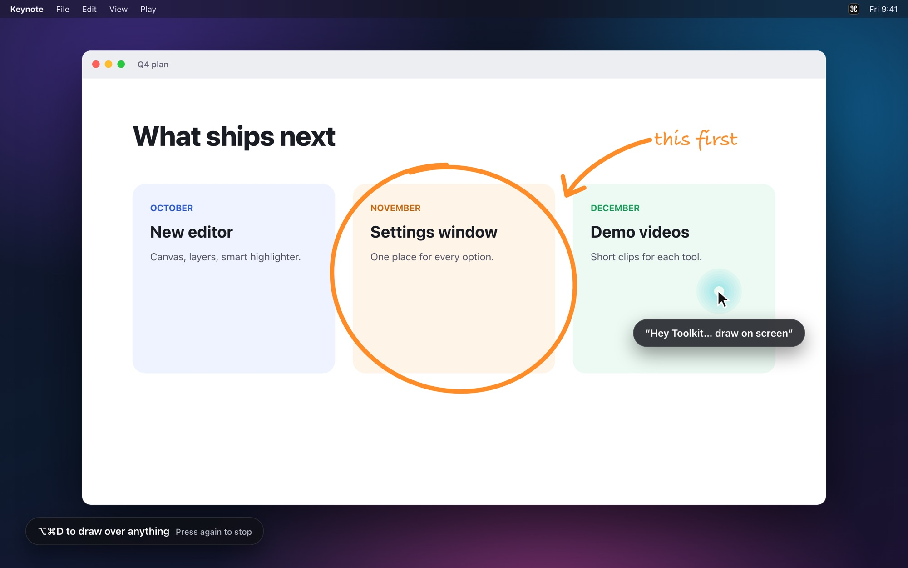
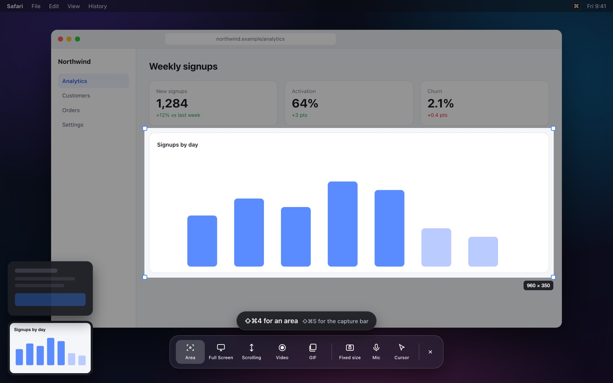
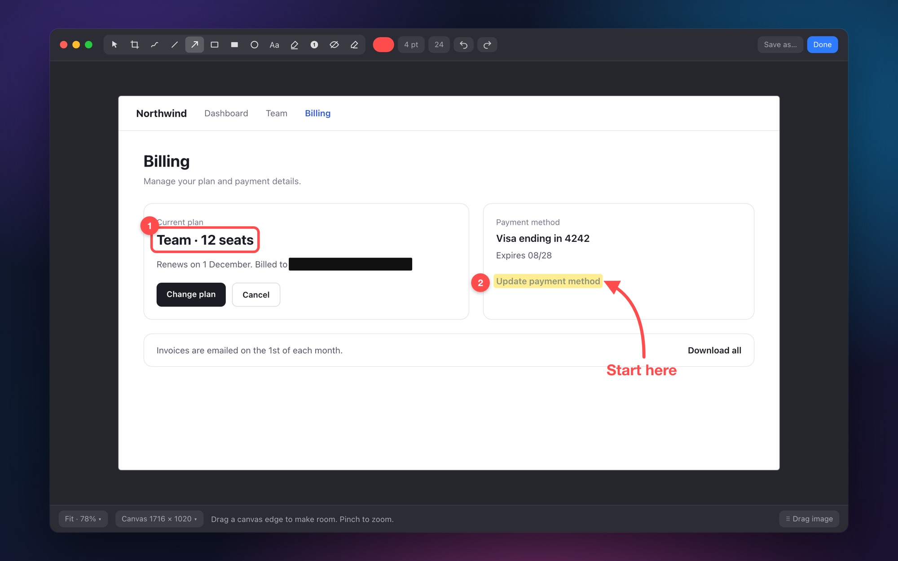
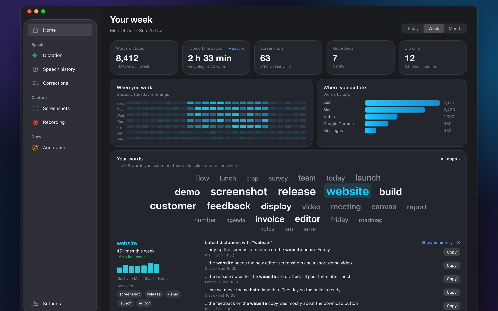

# OpenToolkit

### Speak it. Capture it. Make it clear.

Local dictation, screenshots, screen drawing and recording in one free Mac app. Hold **Fn** or say **"Hey Toolkit"** to dictate. Lost the text? **Double-tap Shift** and your last dictation pastes again.

**Apple Silicon · macOS 14+ · Free and open source (MIT) · Notarized by Apple · Early preview**

[Download the latest release →](https://github.com/Barty-Bart/opentoolkit/releases/latest) · [opentoolkit.app](https://opentoolkit.app)



## What it does

| | |
| --- | --- |
| **Dictation** | Hold **Fn** and speak into the text box you're in. Speech is transcribed on your Mac with Parakeet or Whisper. Switch to AirPods or a headset and it picks up the new microphone by itself. |
| **Dictation history** | **Double-tap Shift** to paste your last transcript again. **Triple-tap** to open everything you've dictated. The key is customisable. |
| **Hey Toolkit** | Say the wake phrase, wait for the cue, then a command: start dictating, take a screenshot, draw on screen, record my screen. A glow around the pointer shows it's listening. Optional and off until you turn it on. |
| **Screenshots** | **⇧⌘4** for an area, on any display. Thumbnails stack in the corner of the display you're on; drag one into another app, or double-click to edit. |
| **Capture bar** | **⇧⌘5** opens a glass capture bar: full screen, fixed dimensions, scrolling capture, video and GIF. |
| **Screenshot editor** | A real canvas you can resize, a second image as its own layer, pinch to zoom. Arrows, shapes, text, numbered steps, redaction and a highlighter that snaps onto words. |
| **Screen drawing** | **⌥⌘D** to draw over your screen. Press it again to stop, or hold it to draw only while it's held. Marks stay until you clear them. |
| **Screen recording** | Record a region as video or GIF. Optionally show a larger cursor, a highlight ring and click ripples. |
| **Home** | Words dictated, typing time saved, captures, recordings and when you work. "Your words" shows up to 40 words you say most, for all apps or one. Click a word for uses per day and your latest dictations with it, with Copy and Show in history. Counted on your Mac; you can turn it off. |
| **Word corrections** | Review suggested corrections after editing a dictation. Save a replacement, undo it, or disable it in Corrections. Support depends on the target text box. |
| **Writing modes** | Tidy spacing and format messages. Optional: bullet summaries and email drafts with a local AI model you run yourself, such as one in LM Studio. |
| **Notes · experimental** | Optional local notes, folders, keyword search and meeting transcripts. Off by default. |
| **Updates** | One click from the menu bar. Each update is checked for Apple notarization and the same developer signature before it installs. |

<table>
<tr>
<td width="50%"><br><sub><b>Double-tap Shift</b> pastes your last dictation. Triple-tap opens this list.</sub></td>
<td width="50%"><br><sub><b>"Hey Toolkit… draw on screen"</b>, or press ⌥⌘D.</sub></td>
</tr>
<tr>
<td width="50%"><br><sub><b>⇧⌘4</b> for an area, <b>⇧⌘5</b> for the capture bar.</sub></td>
<td width="50%"><br><sub>The editor: steps, highlight, redaction, arrows.</sub></td>
</tr>
<tr>
<td colspan="2"><br><sub><b>Home</b>: your week, counted on your Mac. Click a word to see where you said it.</sub></td>
</tr>
</table>

<sub>Screens are illustrations of the app with made-up content.</sub>

## Say "Hey Toolkit"

Turn on **Listen for wake phrase** on the Dictation card first.

```text
"Hey Toolkit" → wait for the sound / waveform → "start dictating"
                                             "take a screenshot"
                                             "draw on screen"
                                             "record my screen"
```

The command window lasts eight seconds. To finish dictating, say **"Hey Toolkit"**, wait for its cue, then **"stop transcribing"**. Change the wake phrase and actions in **Dictation → Customize wake phrase & commands**. Sending, Notes and meeting capture require their settings to be enabled. "Summarize into bullet points" and "turn this into an email" need a local text model, such as one served by LM Studio.

## Get started

1. Download the DMG from the [latest release](https://github.com/Barty-Bart/opentoolkit/releases/latest).
2. Open it and drag **OpenToolkit** into Applications, then open it from there.
3. Pick the tools you want and grant the macOS permissions it asks for. The dictation model downloads the first time you use it, and retries by itself if the download is interrupted.
4. Hold **Fn** and start talking.

No Python, Homebrew or developer tools needed. OpenToolkit appears in the menu bar and the Dock. It does not import another app's history.

**Build from source:** install Python 3.12 and Xcode Command Line Tools, clone this repository, then run:

```sh
python3.12 scripts/install.py --check
python3.12 scripts/install.py
```

The app appears in `~/Applications/OpenToolkit.app`. Setup downloads the speech dependencies and model, then guides you through the required Mac permissions.

[Installation, permissions and existing models →](docs/installation.md)

## Update

Choose **Check for Updates…** in the menu bar, then **Download & install**. OpenToolkit also checks once a day and shows a dot on the menu-bar icon when a new version is ready.

It waits until you're not dictating or recording, downloads the release from this repository, and installs it only if Apple notarized it and it's signed by the same developer. Then it restarts into the new version. Your history, settings and permissions stay as they are, and the previous version is kept for rollback.

## Useful shortcuts

| Action | Default |
| --- | --- |
| Dictate | Hold Fn, or tap to toggle |
| Start or stop dictation | ⌥ ⌘ T |
| Paste last transcript again | Double-tap Shift |
| Open dictation history | Triple-tap Shift |
| Capture area | ⌘ ⇧ 4 |
| Capture full screen | ⌘ ⇧ 3 |
| Capture bar: dimensions, scrolling, video & GIF | ⌘ ⇧ 5 |
| Draw on screen | ⌥ ⌘ D |
| Record screen | ⌥ ⌘ R |

Shortcuts are configurable. If macOS or another capture tool also uses ⌘ ⇧ 3/4/5, turn theirs off.

## Local by default

Speech recognition runs on your Mac. History, approved corrections, notes and captures are stored locally. No telemetry, account, cloud transcription or sync. Optional AI writing connects only to a local server you choose. Microphone dictation does not require FFmpeg.

This is an early preview. Text-box insertion, correction detection and screenshot behaviour are still being hardened; test them in your own apps before relying on them. English is configured, screen recording with microphone needs macOS 15+, and older supported macOS versions still need hardware testing. Notes AI summaries, semantic search, profile sync and camera overlays are future work.

[Privacy and limitations](docs/privacy-and-limits.md) · [Testing](docs/testing.md) · [Report a problem](https://github.com/Barty-Bart/opentoolkit/issues)

Please use a synthetic example when reporting a bug. Do not upload your private transcripts, recordings, screenshots or credentials.

## License

OpenToolkit is released under the [MIT License](LICENSE). Bundled third-party components keep their own licenses; their notices ship inside the app.
