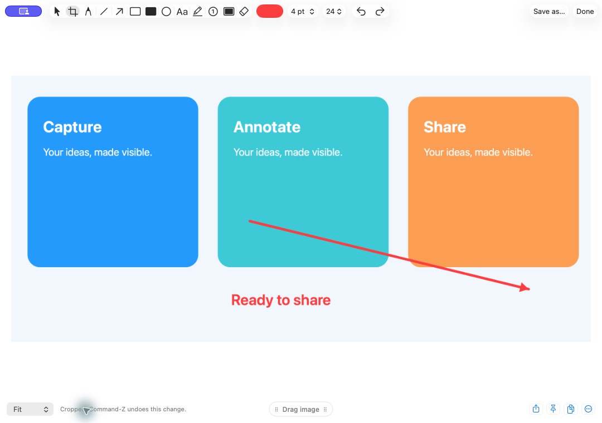

# OpenToolkit

### Speak it. Capture it. Make it clear.

Everyday Mac tools in one local app: dictation, screenshots, annotation and quick screen recordings, with optional notes.

**Apple Silicon · macOS 14+ · Early source preview**

| | In the public source preview |
| --- | --- |
| 🎙️ **Dictation** | Hold **Fn** to speak into a text box. Choose Parakeet or Whisper, GPU or CPU, live typing, colours and sounds. |
| 🪄 **Word corrections** | Review suggested replacements after editing your dictation. Save, undo or disable corrections. Detection depends on the text box. |
| ↩️ **Recover lost text** | **Double-tap Shift** to paste the last saved transcript; triple-tap to open history. Change the recovery key or turn it off. |
| 📸 **Screenshots** | Capture an area or full screen. Copy, save, dismiss or drag a floating preview into another app. |
| ✏️ **Edit screenshots** | Crop, draw arrows and shapes, add text, and combine images. |
| 🖍️ **Screen annotation** | Hold a configurable hotkey to draw over your screen. Release to keep working; clear the marks when finished. |
| 🎬 **Screen recording** | Capture a region as video or GIF. Capture options also include fixed dimensions and scrolling screenshots. |
| 📝 **Notes · experimental** | Optional notes, folders, keyword search and meeting transcripts. Off by default; dictation keeps its own history. |

## Development preview

The next update brings the **“Hey Toolkit” → cue → command** flow, a redesigned screenshot editor, and optional local AI writing for bullet summaries and email drafts. These newer changes are **not yet included in the public source snapshot**.



*The new editor in development, shown with demonstration artwork. This is not a screenshot of the current public build.*

## Try the source preview

The project is now **OpenToolkit**. The current public installer still creates the legacy **Pico.app**; the app rename is part of the next code update. There is **no public DMG release yet**.

Install Python 3.12 and Xcode Command Line Tools, clone this repository, then run from its folder:

```sh
python3.12 scripts/install.py --check
python3.12 scripts/install.py
```

Open `~/Applications/Pico.app`. It has a Dock icon and menu-bar access. Setup creates a separate speech environment, downloads dependencies, and lets you choose a model. Speech weights download on first use; allow several GB of disk space. Recognition then runs on your Mac.

Stop speech in Setup and quit the app before updating. This source installer uses ad-hoc signing, so macOS can require permissions again after a rebuild. **Do not use this older source installer over a newer signed development installation.** Follow [GitHub Releases](https://github.com/Barty-Bart/opentoolkit/releases) for future packaged builds.

## Useful shortcuts

| Action | Default |
| --- | --- |
| Dictate | Hold Fn, or tap to toggle |
| Recover last transcript / open history | Double / triple Shift |
| Capture area | ⌘ ⇧ 4 |
| Capture full screen | ⌘ ⇧ 3 |
| Capture options: dimensions, scrolling, video & GIF | ⌘ ⇧ 5 |

Shortcuts are configurable. macOS or another capture app may already use the same combination. Optional voice commands use individually configured phrases in this public preview; wake listening and sending are off by default.

## Local by default

Speech recognition, history, approved corrections, notes and captures stay on your Mac. No telemetry, account, cloud transcription or profile sync. Setup downloads packages and model weights from their hosts. Runtime data stays outside this repository in the app's local Application Support folder.

This is an early preview. Text insertion, correction detection, caret placement and drag-and-drop support vary by app. English is configured; screen recording with microphone requires macOS 15+. The macOS 14 minimum still needs testing on a separate Mac. Public-preview writing modes format text; its bullet mode splits sentences and **does not summarize**. Notes AI summaries, semantic search, profile sync and camera overlays remain future work.

[Speech models and GPU/CPU options](docs/speech.md) · [Tests and limitations](docs/testing.md) · [Report a problem](https://github.com/Barty-Bart/opentoolkit/issues)

Please report bugs with synthetic examples. Keep private transcripts, recordings, screenshots, settings and credentials out of issues and commits.
